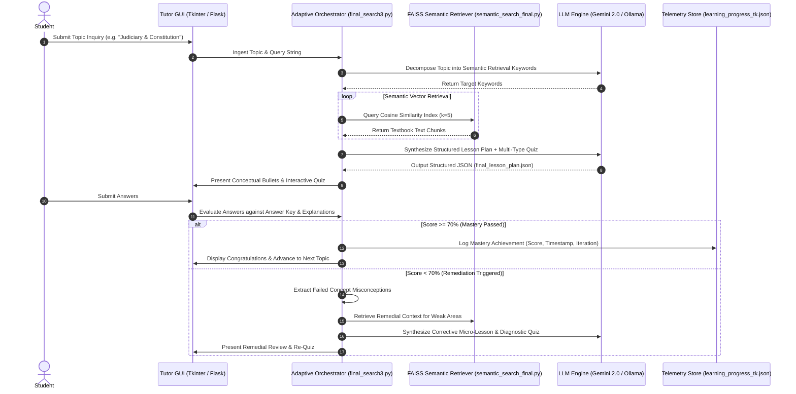

<div align="center">

# 🎓 Adaptive Learning Chatbot & AI Pedagogical Engine

### Personalized Education Support System with FAISS Vector Semantic Search (RAG), Gemini/Ollama Reasoning, Dynamic Lesson Synthesis, and Remediation Feedback Loops

[](https://www.python.org/)
[](LICENSE)
[](tests/)
[](#-rag--semantic-retrieval-pipeline)
[](#-pedagogical-reasoning-engine)
[](#-dual-user-interfaces)
[](https://peps.python.org/pep-0008/)

<p align="center">
  <b>Project Authors:</b> Palak • <a href="https://github.com/Quirrells-Quill">Khushal (Quirrells-Quill)</a>
</p>

<p align="center">
  <a href="#-executive-summary">Executive Summary</a> •
  <a href="#-system-architecture">Architecture</a> •
  <a href="#-key-features--pedagogical-mechanics">Key Features</a> •
  <a href="#-rag--semantic-retrieval-pipeline">RAG Pipeline</a> •
  <a href="#-dual-user-interfaces">User Interfaces</a> •
  <a href="#-quickstart--installation">Quickstart</a> •
  <a href="#-testing--verification">Testing</a> •
  <a href="#-future-roadmap">Roadmap</a>
</p>

---

</div>

## 📖 Executive Summary

While contemporary artificial intelligence applications are predominantly deployed for enterprise automation and commercial workflows, educational technology often remains constrained by static multiple-choice banks, rigid non-adaptive curricula, and passive rote learning.

The **Adaptive Learning Chatbot for Personalized Education Support** introduces an autonomous, student-centric pedagogical engine that transforms textbooks into interactive, personalized tutoring experiences. Built using **Retrieval-Augmented Generation (RAG)** over official curriculum corpora (e.g., NCERT Science, Civics, Biology, and Physics), the system combines dense vector retrieval via **FAISS** with state-of-the-art LLM reasoning (**Google Gemini 2.0 Flash** and local **Ollama DeepSeek-R1**).

### The Adaptive Mastery Loop
Unlike conventional conversational bots that provide unstructured open-ended answers, this system implements a strict, closed-loop pedagogical framework:
1. **Curriculum Grounding:** Extracts relevant educational context from textbook vectors to eliminate hallucinations.
2. **Micro-Lesson Synthesis:** Generates concise bulleted conceptual summaries tailored to the learner's inquiry.
3. **Multi-Modal Diagnostic Quizzing:** Dynamically formulates diagnostic quizzes spanning recall, true/false, conceptual reasoning, and previous-year question (PYQ) patterns.
4. **Adaptive Remediation:** If the learner scores below the mastery threshold ($< 70\%$), the engine analyzes specific misconceptions, retrieves targeted corrective concepts from the vector index, formulates a remedial lesson, and administers a targeted follow-up quiz until mastery is achieved.
5. **Persistent Telemetry:** Logs comprehensive competency trajectories, response histories, and iterative progress to `learning_progress_tk.json`.

---

## 🏛️ System Architecture

The following diagram illustrates the complete closed-loop lifecycle from student query ingestion to adaptive remediation:



---

## 🌟 Key Features & Pedagogical Mechanics

### 1. Dynamic, Non-Static Quiz Formulation
Rather than recycling predetermined static questions, the quiz generator constructs a heterogeneous mix of question types for every module:
- **Multiple Choice (`mcq`):** Diagnostic 4-choice questions testing core recall and factual precision.
- **True / False (`tf`):** Rapid verification of foundational definitions.
- **Short Answer (`short`):** Concise conceptual retrieval.
- **Analytical Reasoning (`reasoning`):** Multi-step causal questions evaluating deep conceptual understanding.

### 2. Previous-Year Question (PYQ) Integration
The engine includes a dedicated PYQ ingestion interface (`pyq_papers/`). When past exam papers are supplied, the prompt generator instructs the model to match the exact question formatting, difficulty level, and analytical rigor expected in standard board examinations.

### 3. Dual LLM Provider Support
- **Cloud Reasoning:** Seamlessly interfaces with Google Generative AI (`gemini-2.0-flash` / `gemini-1.5-pro`) for high-speed, zero-infrastructure generation.
- **Local Private LLM (Ollama):** Optional local inference hook supporting models such as `deepseek-r1:1.5b` or `llama3` for offline, zero-data-leakage school environments.

---

## 🔍 RAG & Semantic Retrieval Pipeline

The knowledge base is constructed from authentic educational textbooks (NCERT Class 9 Science, Constitution and Civics, Biology, etc.):

```
[Raw Curriculum PDFs]
        │
        ▼ (text_extract.py via PyMuPDF)
[Clean Extracted Text]
        │
        ▼ (chunky_text.py with Overlapping Sliding Windows)
[Semantic Chunks (dataset_chunked.csv)]
        │
        ▼ (Embeddings_optimized.py via nomic-embed-text)
[Normalized 768-dim Embeddings (embeddings.npy)]
        │
        ▼ (faiss.IndexFlatIP / IndexIVFFlat)
[FAISS Inner-Product Cosine Index (faiss_index.bin)]
```

### Mathematical Formulation
To guarantee true cosine similarity using inner-product search, all embedding vectors $\mathbf{e}_i \in \mathbb{R}^{768}$ are normalized to unit Euclidean length:

$$\tilde{\mathbf{e}}_i = \frac{\mathbf{e}_i}{\|\mathbf{e}_i\|_2 + \epsilon}$$

For any query vector $\mathbf{q}$, the cosine similarity reduces to a fast matrix dot product:

$$\text{Sim}(\mathbf{q}, \mathbf{e}_i) = \tilde{\mathbf{q}}^\top \tilde{\mathbf{e}}_i = \cos(\theta)$$

Search queries execute in sub-millisecond times over thousands of curriculum passages using FAISS inverted file indexing (`IVF` with $n_{\text{list}} = 256$, $n_{\text{probe}} = 16$).

---

## 🖥️ Dual User Interfaces

The repository includes two complementary client frontends:

### 1. Desktop Tutor GUI (`final_search3.py`)
A comprehensive Tkinter desktop application featuring:
- **Topic Search Bar:** Allows instant exploration of any scientific, civic, or biological concept.
- **Live Progress Telemetry:** Displays step-by-step reasoning status and keyword searches.
- **Interactive Quiz Form:** Renders radio buttons for MCQs, text inputs for short answers, and instant feedback validation.
- **Session History & Analytics:** Tracks mastery progress across multi-round sessions.

### 2. Web Lesson Viewer (`serve_lesson.py`)
A lightweight Flask web application that serves `final_lesson_plan.json` directly in any web browser at `http://127.0.0.1:7860`.
- Responsive, clean layout.
- Embedded client-side JavaScript scoring engine.
- Instant feedback rendering with detailed explanation cards.

---

## 📁 Repository Structure

```text
AI-Chatbot-learning/
├── final_search3.py             # Main Desktop Tutor GUI (Tkinter) & Adaptive Learning Orchestrator
├── semantic_search_final.py     # FAISS vector semantic search engine with cosine normalization
├── serve_lesson.py              # Flask web server rendering interactive lessons & browser quizzes
├── chunky_text.py               # Text chunking with overlapping semantic sliding windows
├── text_extract.py              # Multi-page PDF text extractor (PyMuPDF / pdfplumber)
├── text_embeddings.py           # Embeddings generator pipeline
├── Embeddings_optimized.py      # Optimized batch embedding generator with FAISS indexing
│
├── final_lesson_plan.json       # Generated structured lesson plan with explanation & quiz objects
├── learning_progress_tk.json    # Student telemetry tracking: scores, iterations, and feedback
├── lessons_cache.json           # Local cache of previously compiled lesson plans
│
├── Customized training data/
│   ├── *.pdf                    # Textbook corpora (NCERT Class 9 Science, Civics, Biology)
│   └── csv_files_for_the_training_data/
│       ├── dataset_chunked.csv  # Segmented curriculum text passages
│       ├── dataset_with_embeddings.csv # Dataset with 768-dim dense embedding vectors
│       ├── embeddings.npy       # Serialized NumPy vector matrix
│       ├── faiss_index.bin      # Pre-built FAISS vector database
│       └── texts.csv            # Passages mapped to index IDs
│
├── Readme and Research/         # Academic project reports & theoretical documentation (.docx)
├── semantic_logs/               # Query execution traces and keyword stdout/stderr logs
├── tests/
│   └── test_chatbot.py          # Automated unit test suite (6 test cases, 100% pass)
├── requirements.txt             # Pinned Python dependencies
├── LICENSE                      # MIT Open-Source License
└── .gitignore                   # Clean bytecode & cache ignore rules
```

---

## 🚀 Quickstart & Installation

### Prerequisites
- Python 3.10, 3.11, or 3.12
- Git
- Google Gemini API Key ([Get an API Key](https://aistudio.google.com/))
- *(Optional)* [Ollama](https://ollama.ai/) with `nomic-embed-text` and `deepseek-r1:1.5b`

### 1. Clone & Setup Environment

```bash
# Clone the repository
git clone https://github.com/Quirrells-Quill/AI-Chatbot-learning.git
cd AI-Chatbot-learning

# Create and activate virtual environment
python -m venv venv

# On Linux / macOS:
source venv/bin/activate
# On Windows:
.\venv\Scripts\activate

# Install dependencies
pip install -r requirements.txt
```

### 2. Configure API Key

Set your Google Gemini API key as an environment variable:

```bash
# On Linux / macOS:
export GEMINI_API_KEY="your_actual_gemini_api_key_here"

# On Windows (PowerShell):
$env:GEMINI_API_KEY="your_actual_gemini_api_key_here"

# On Windows (CMD):
set GEMINI_API_KEY=your_actual_gemini_api_key_here
```

### 3. Launch the Desktop Tutor GUI

```bash
python final_search3.py
```
- Enter any curriculum topic (e.g. `Cell Structure`, `Newton's Laws`, `Democracy & Rights`).
- The engine retrieves relevant textbook chunks, synthesizes a micro-lesson, and generates a dynamic diagnostic quiz!

### 4. Or Launch the Web Lesson Viewer

```bash
python serve_lesson.py
```
Open your browser at `http://127.0.0.1:7860` to review the current lesson and complete interactive quizzes in your browser.

---

## 🧪 Testing & Verification

The repository includes an automated unit test suite validating lesson schema integrity, student progress logging, vector normalization mathematics, and Flask routes.

Run tests using `pytest`:

```bash
pytest tests/ -v
```

Output:
```text
tests/test_chatbot.py::TestLessonPlanSchema::test_lesson_plan_file_exists_and_valid PASSED     [ 16%]
tests/test_chatbot.py::TestLessonPlanSchema::test_quiz_questions_structure PASSED             [ 33%]
tests/test_chatbot.py::TestLearningProgress::test_learning_progress_file_structure PASSED     [ 50%]
tests/test_chatbot.py::TestVectorSearchMath::test_l2_normalization_for_cosine_similarity PASSED [ 66%]
tests/test_chatbot.py::TestFlaskLessonServer::test_index_route PASSED                         [ 83%]
tests/test_chatbot.py::TestFlaskLessonServer::test_api_lesson_endpoint PASSED                 [100%]

============================== 6 passed in 0.75s ==============================
```

---

## 🛠️ Future Roadmap

- [x] **RAG Retrieval Pipeline over Textbook Corpora with FAISS**
- [x] **Dynamic Multi-Modal Quiz Formulation (MCQ, True/False, Short, Reasoning)**
- [x] **Adaptive Remediation Loops with 70% Mastery Gates**
- [x] **Desktop Tkinter GUI + Flask Web Viewer**
- [ ] **Spaced Repetition Scheduling:** Integrate SuperMemo SM-2 algorithms to schedule optimal review intervals based on historical forgetting curves.
- [ ] **Voice Interaction:** Add bidirectional speech-to-speech tutoring using Whisper and neural text-to-speech.
- [ ] **Multi-User Cloud Backend:** Migrate local JSON telemetry stores to PostgreSQL/Supabase with teacher monitoring dashboards.

---

## 📄 License & Attribution

Distributed under the **MIT License**. See [`LICENSE`](LICENSE) for complete terms.

Engineered with ❤️ by **Palak** and **[Khushal (Quirrells-Quill)](https://github.com/Quirrells-Quill)**.
Contributions, feature suggestions, and educational research collaborations are warmly welcomed!
